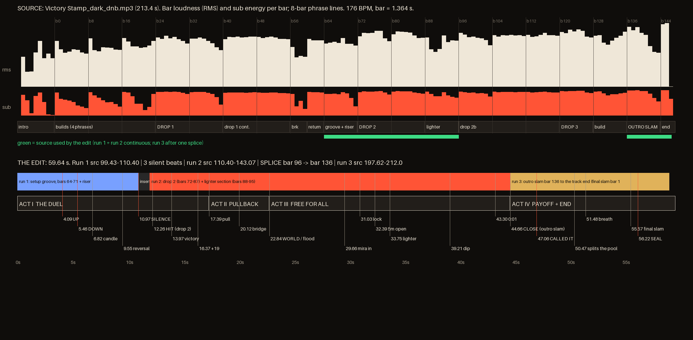

# Music map: `Victory Stamp_dark_dnb.mp3`

**I can't hear audio.** Everything here is objective measurement (onsets, per-bar loudness and band energy, phrase
novelty), and the edit is built from it. **Nothing has been auditioned.** Please judge it by ear, above all the
splice at 44.66 s and the 3-beat silence at 10.97 s.

## The source

- **File:** `last-candle-standing/v4/music-source/Victory Stamp_dark_dnb.mp3` (owner's track, added for BATTLE ROYALE
  V2; md5 `009011fa…7d10d7df`, identical to the v2 and v3 copies; the same file THE LAST STAND uses). Not substituted.
- **Length:** 213.4 s, 48 kHz stereo.
- **Tempo:** 176 BPM, constant from 12 s to ~204 s (beat 0.34095 s, bar 1.3638 s; beat *n* at 12.144 + *n* × 0.34095).
  Re-verified here: onset phases cluster on the grid's on-beat and half-beat (`audio/analysis.json`,
  `onset_phase_hist`). The outro slows from ~205 s (a ritardando into the last stab).
- **Phrases:** 8 bars (32 beats) from bar 0 at 12.144 s. Section changes line up with phrase lines.

## Structure (measured: `audio/analyse.py` → `analysis.json`, `music-map.png`)

| source | bars | section | evidence | narrative use |
|---|---|---|---|---|
| 0–12.1 | −8…−1 | intro | low sub, irregular hits | not used |
| 12.1–44.9 | 0–23 | four builds | each phrase opens with a sub hit that drains away | not used (too long to wait for) |
| **44.9–66.7** | 24–39 | **drop 1** | full sub, strong backbeat onsets (46.9, 47.6, 49.7…) | not used (a 2nd film could open here) |
| 66.7–88.5 | 40–55 | drop 1 continues | flat, steady | not used |
| 88.5–94.0 | 56–59 | breakdown | sub out, top end falls away | (BR V2 used it) |
| 94.0–99.4 | 60–63 | the return | slam, mid-heavy groove | not used |
| **99.4–110.3** | **64–71** | **groove + riser** | phrase start at 64; sub cut at bar 71 (108.97) into the drop | **Act I: the duel's setup; the reversal on the riser** |
| **110.3–132.2** | **72–87** | **drop 2** | the track's biggest single onset (110.68); hits 112.05, 114.78, 117.0 | **the hit (72), the victory (73–75), the pullback (76–79), the field fills (80–87)** |
| **132.2–143.1** | **88–95** | **lighter section** | hi-hats and sub drop back; an accent at bar 92 | **Act III tension: the 5-minute candle; the dip on bar 92; the last second on bar 95** |
| 143.1–175.8 | 96–119 | drop 2b | steady, similar to drop 2 | cut (it would repeat drop 2's energy) |
| 175.8–186.7 | 120–127 | drop 3 | the loudest drop | alternative payoff (see below) |
| 186.7–197.6 | 128–135 | build | top end out, rising | not used |
| **197.6–208.5** | **136–143** | **outro slam** | the loudest bar in the track (136); hits every 2 beats 199.3–204.1; sub cut 204.4–207.5 | **Act IV: the close, CALLED IT, the payouts, the breath** |
| **208.5–213.4** | **144–146** | **the end** | final slam (208.53), last stab (209.18), decay below −30 dB by 211.3 | **the end card stamps on the stab, holds on the decay** |

## The edit (`audio/build_audio.py` → `audio/out/edl.json`)

| video | source | what |
|---|---|---|
| 0.000–10.972 | 99.432–110.399 | **run 1**: bars 64–71 from the phrase start (THE LAST STAND began mid-phrase at 102.32; the longer film gets the whole phrase) |
| 10.972–11.995 | (silence) | **3 inserted silent beats**, exactly as approved in THE LAST STAND v2 (disbelief, her eyes) |
| 11.995–44.664 | 110.399–143.070 | **run 2**: drop 2 and the lighter section, continuous, to the bar line where the source would re-enter at bar 96 |
| 44.664 | **splice** | **bar 96 → bar 136**: phrase start to phrase start, slam to slam, 10 ms / 12 ms fades |
| 44.664–59.04 | 197.620–212.000 | **run 3**: the outro slam to the track's own ending, 0.8 s fade on the decay |
| 59.04–59.64 | (silence) | end-card tail |

**Why this shape.** The Duels short's problem was that the track hit its best material as the picture ended. Here
the duel takes only the groove and drop 2's first bars; drop 2 then carries the victory and the reveal, the lighter
section carries the suspense, and the biggest sound in the file (the outro slam) is saved for the outcome that
matters most. The film ends on the track's real ending, not a fade.

**The one splice, and its risk.** Bar 95 → bar 136 replaces the lighter section's natural re-entry (bar 96, sub 39.5)
with the outro slam (bar 136, sub 41.7), both phrase-first bars after a sparser bar. Same track, same tempo, same key.
What I can't know without listening: whether bar 136's slam arrives with a melodic or harmonic change that bar 95
doesn't prepare (bar 135 is a rising build; bar 95 is a sparse bar). If it feels abrupt, the fall-backs, in order:
1. Let run 2 continue through bar 96 and splice later, at bar 104 → bar 136 (+10.9 s: a 70.5 s film, too long), or
2. splice **bar 96 → bar 120** (drop 3) and end with a second splice bar 128 → bar 144 (two splices, ~58 s), or
3. keep the natural re-entry at bar 96 as the close (no splice) and fade under a generated end (loses the real ending).

**Other uncertainties:** the 3-beat silence was approved in a 17.6 s film; at 60 s it may want to be 2 beats.
The SFX stem is placeholder synthesis (stamps, hit, whooshes, entry chips), cue-listed in `edl.json`.

## Stems (all 48 kHz, separate)

- `audio/out/music.wav`: the edit only.
- `audio/out/sfx.wav`: placeholder effects only.
- `audio/out/mix.wav`: both (music ×0.85, sfx ×0.6, peak-normalised). The animatic MP4s carry this.
- `audio/out/edl.json`: every segment in source and video time, the SFX cues.

Re-timing the music re-times the picture: `build_audio.py` writes `remotion/src/timing.json` from source times.

## Narrative sync (what lands where)

| video | music | picture |
|---|---|---|
| 4.09 / 5.46 | bars 67 / 68 | his UP lock / her DOWN lock |
| 9.55 | bar 71, the sub cut (riser) | the candle reverses |
| 10.97 | silence | disbelief |
| 12.26 | drop 2's big hit | THE HIT |
| 13.97 | drop 2 hit | the victory reveal |
| 17.39 | bar 76 | the pullback starts |
| 20.12 | bar 78 | the hand-over to the wide plate |
| 22.84 | bar 80 (drop 2's second half) | the world → the ink flood, the round begins |
| 22.84–29.66 | every 2 beats | eleven entries; mira last (29.66, bar 85) |
| 31.03 / 32.39 | bars 86 / 87 | picks lock / the 5M candle opens |
| 33.75 | bar 88, the lighter section | tension |
| 39.21 | bar 92 accent | it dips under the strike; Rampage |
| 43.30 | bar 95 | 0:01 |
| **44.66** | **the outro slam (bar 136)** | **CLOSED UP** |
| 47.06 → 51.16 | the 2-beat hits | CALLED IT, the payouts, the line |
| 51.48 | the sub cut | the breath |
| 55.57 / 56.22 | final slam / last stab | flood to paper / the seal stamps |
